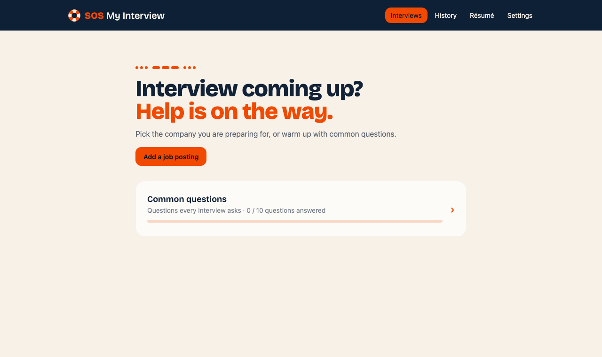

# SOS My Interview

[English](README.md) | **한국어**

[](https://github.com/gyedongjeon/sos-my-interview/releases/latest)
[](LICENSE)

면접이 코앞인가요? **영어 면접**을 내 컴퓨터에서 연습하는 모의 면접 앱입니다. 면접관이 질문을 소리 내어
읽어 주고, 답변을 녹화한 뒤, 영어와 답변 내용을 각각 채점해 줍니다.



## 주요 기능
- **듣기부터 연습**: 면접관이 질문을 음성으로 읽어 주고, 질문 글자는 버튼을 눌러야 보입니다.
- **꼬리 질문**: 방금 한 답변을 파고드는 질문이 최대 두 번 이어집니다.
- **두 가지 점수**: 영어(문법, 어휘, 자연스러움, 발음, 억양, 강세)와 내용(관련성, 구조, 구체성)을 따로 채점하고, 고친 문장과 더 나은 답변 예시를 보여 줍니다.
- **한국어 피드백**: 설명은 한국어로 받을 수 있습니다. 질문과 모범 답안은 영어 그대로입니다.
- **지원하는 회사에 맞춘 질문**: 채용 공고(링크 또는 본문)와 이력서를 넣으면 그 직무에 맞는 질문을 만들어 줍니다.
- **기록**: 모든 답변이 전사문, 점수, 녹화와 함께 저장되어 실력이 느는 과정을 볼 수 있습니다.
- **내 컴퓨터에서 실행**: 음성 인식과 면접관 목소리는 컴퓨터 안에서 처리되고, 데이터도 내 컴퓨터에만 저장됩니다. 피드백에 필요한 내용(답변 글과 발음 채점용 음성, 직접 넣은 이력서와 채용 공고)만 내가 고른 AI 서비스로 전송됩니다.

계정 가입이나 서버가 없는 1인용 앱입니다.

## 설치 (Apple Silicon Mac)
1. [최신 릴리스](https://github.com/gyedongjeon/sos-my-interview/releases/latest)에서 `.dmg` 파일을 내려받아 열고, 앱을 Applications 폴더로 끌어다 놓습니다.
2. Apple 개발자 인증서로 서명되지 않은 앱이라 처음에는 macOS가 실행을 막습니다. 터미널에서 아래 명령을 한 번 실행한 뒤 앱을 엽니다.
   ```bash
   xattr -cr "/Applications/SOS My Interview.app"
   ```
3. 첫 실행 때 Python과 필요한 패키지를 내려받습니다. 인터넷 연결이 필요하고 몇 분 걸릴 수 있습니다. 카메라와 마이크 권한을 물으면 허용해 주세요.

따로 설치할 프로그램은 없습니다.

Intel Mac, Windows, Linux용 설치 파일은 아직 없습니다. 이 경우 [소스에서 실행](README.md#run-from-source)할 수 있습니다.

## 업데이트
0.3.0 버전부터는 앱을 열 때 새 버전이 있는지 확인합니다. 새 버전이 있으면 알림 창이 뜨고, "Update and Restart"를 누르면 앱이 새 버전을 내려받아 스스로 교체한 뒤 다시 열립니다. 면접 기록과 설정은 그대로 유지됩니다. 메뉴의 **SOS My Interview → Check for Updates…**로 직접 확인할 수도 있습니다.

- 업데이트 뒤에 macOS가 카메라와 마이크 권한을 다시 물을 수 있습니다.
- 앱을 Applications 폴더로 옮기지 않고 실행한 경우 등 스스로 교체할 수 없을 때는 다운로드 페이지를 열어 줍니다.

## 처음 설정
앱을 처음 열면 Settings 화면이 나옵니다.

1. **Feedback language**: 피드백 설명을 받을 언어를 고릅니다. 시스템 언어가 한국어면 한국어가 미리 선택되어 있습니다.
2. **AI model**: 사용할 AI 서비스(Provider)와 모델을 고르고, 그 서비스의 API 키를 붙여 넣은 뒤 "Save and test"를 누릅니다.

처음이라면 **Google Gemini**를 추천합니다. 무료 사용량이 있고, 발음·억양·강세 채점에 필요한 음성 입력을 지원합니다. API 키는 [Google AI Studio](https://aistudio.google.com/apikey)에서 발급받을 수 있습니다. Claude, OpenAI, OpenRouter 등 다른 서비스도 쓸 수 있습니다.

API 키는 내 컴퓨터에만 저장되고, 저장한 뒤에는 화면에 다시 표시되지 않으며, 선택한 서비스로만 전송됩니다.

## 사용 방법
1. **Interviews**에서 "Common questions"(공통 질문)를 고르거나, "Add a job posting"으로 채용 공고를 추가합니다.
2. 질문을 골라 "Answer"를 누르면 면접관이 질문을 읽어 줍니다. 못 들었다면 "Replay question", 글자로 보고 싶다면 "Show question"을 누릅니다.
3. "Start answer"로 답변을 시작하고 "Stop answer"로 마칩니다. 꼬리 질문이 이어집니다.
4. "Get feedback"을 누르면 점수와 피드백이 나옵니다.
5. 지난 답변은 **History**에서 다시 볼 수 있습니다.

## 자주 묻는 질문
- **앱이 "손상되었다"거나 "확인되지 않은 개발자"라며 열리지 않아요.** 설치 2번의 `xattr -cr` 명령을 실행해 주세요.
- **처음 실행했는데 한참 기다려야 해요.** 첫 실행 때만 Python 패키지(약 450MB)를 내려받습니다. 다음부터는 바로 열립니다.
- **화면 위에 "Downloading the speech models"가 떠 있어요.** 앱을 처음 열면 음성 인식 모델(약 480MB)과 면접관 음성 모델(약 350MB)을 한 번 내려받습니다. 진행률이 표시되고, 받는 동안에도 앱을 쓸 수 있습니다.
- **면접관 목소리가 처음에는 기계음 같아요.** 음성 모델을 내려받는 동안은 시스템 기본 음성으로 읽어 줍니다. 다운로드가 끝나면 자연스러운 목소리로 바뀝니다.
- **첫 답변이 "Downloading the speech recognition model"에서 기다려요.** 음성 인식 모델을 다 받기 전에 답변하면, 다운로드가 끝난 뒤에 자동으로 이어서 처리됩니다. 답변은 사라지지 않습니다.
- **발음 점수가 Pronunciation 하나만 나와요.** 음성 입력을 지원하지 않는 모델에서는 억양과 강세를 채점하지 못합니다. Gemini 모델을 쓰면 세 가지가 모두 나옵니다.
- **화면이 영어예요.** 영어 면접 연습용이라 화면은 영어로 두었습니다. 피드백 설명은 Settings에서 고른 언어로 나옵니다.
- **내 데이터는 어디에 있나요?** `~/Library/Application Support/SOS My Interview/data/`에 저장됩니다. 백업하거나 다른 Mac으로 옮길 때는 이 폴더를 복사하면 됩니다.

## 완전히 삭제하기
앱을 휴지통에 넣어도 앱이 만든 파일은 남습니다. 완전히 지우려면 앱을 삭제한 뒤 아래 폴더를 지워 주세요. 면접 기록, 녹화, 음성 모델, Python 패키지가 모두 이 폴더 하나에 들어 있습니다.

```
~/Library/Application Support/SOS My Interview/
```

0.3.0 이하 버전을 쓴 적이 있다면 공용 캐시 폴더에도 파일이 남아 있을 수 있습니다. `~/.cache/huggingface/hub/models--Systran--faster-whisper-small.en`을 지우고, 다른 프로그램이 uv를 쓰지 않는다면 `~/.cache/uv`도 지워도 됩니다.

## 개발과 기여
소스에서 실행하는 방법, 테스트, 프로젝트 구조는 [영어 README](README.md)를 참고해 주세요.

## 라이선스
[MIT](LICENSE). 앱에 포함된 글꼴과 라이브러리의 라이선스는 [THIRD_PARTY_NOTICES.txt](frontend/public/THIRD_PARTY_NOTICES.txt)와 앱의 Settings 화면에서 볼 수 있습니다.
