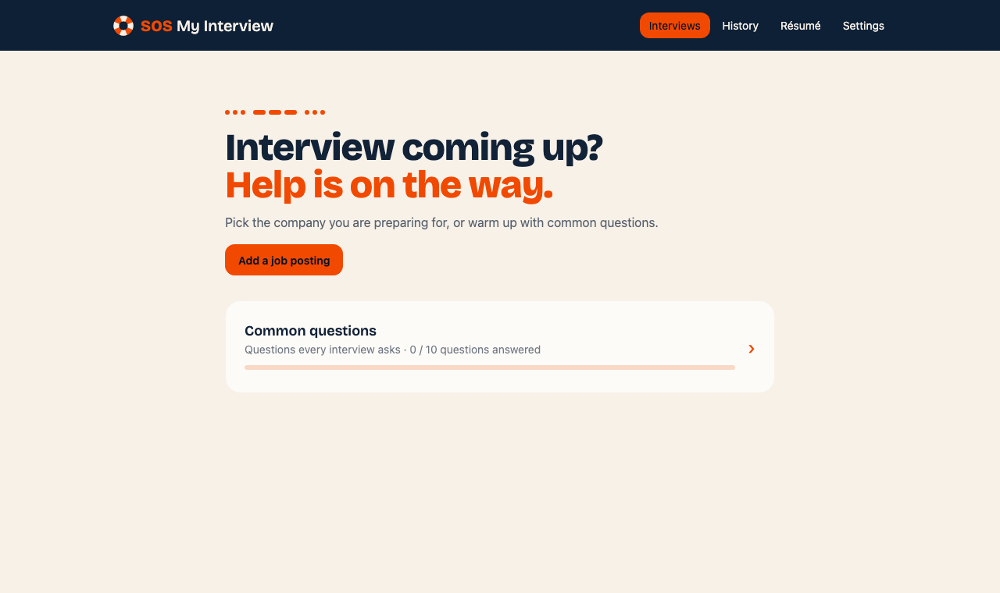

# SOS My Interview

**English** | [한국어](README.ko.md)

[](https://github.com/gyedongjeon/sos-my-interview/releases/latest)
[](https://github.com/gyedongjeon/sos-my-interview/actions/workflows/ci.yml)
[](LICENSE)

Interview coming up? A mock interview app for practising job interviews **in English**, running on
your own machine. It asks the questions aloud, records your answer, and scores both your English
and what you said.



## Features
- **Listening first**: the interviewer reads each question aloud, and its text stays hidden until you ask for it.
- **Follow-up questions**: up to two follow-ups dig into what you just said, as a real interviewer would.
- **Two separate scores**: English (grammar, vocabulary, naturalness, pronunciation, intonation, stress) and content (relevance, structure, specificity), with corrected sentences and a stronger version of your answer.
- **Feedback in your language**: explanations in Korean, Japanese, Chinese, Spanish, and more; questions and model answers stay in English.
- **Questions for the job you want**: add a job posting (link or text) and your résumé to get questions written for that role.
- **History**: every answer is kept with its transcript, scores, and recording, so you can see how you improve.
- **Private by default**: speech-to-text and the interviewer's voice run locally, and your data stays on your computer. Only what the feedback needs goes to the LLM provider you choose, with your own API key: your answers (text, and audio for pronunciation scoring) and the résumé and job postings you add.

The app runs locally for a single user; there is no account, server, or deployment.

## Install
Installers for **Apple Silicon Macs** and **64-bit Windows** are attached to each
[release](https://github.com/gyedongjeon/sos-my-interview/releases/latest).

### macOS

1. Download the `.dmg`, open it, and drag the app to Applications.
2. The build is not signed with an Apple developer certificate, so macOS blocks it at first. Run
   this once in Terminal, then open the app:
   ```bash
   xattr -cr "/Applications/SOS My Interview.app"
   ```
3. The first launch downloads Python and the Python packages, so it needs an internet connection
   and can take a few minutes. Allow camera and microphone access when asked.

Nothing else has to be installed, because the app ships its own [uv](https://docs.astral.sh/uv/).

### Windows
1. Download `SOS-My-Interview-Setup-<version>.exe` and run it. It installs for your user account
   only and needs no administrator rights.
2. The installer is not signed, so Windows shows "Windows protected your PC". Choose
   **More info**, then **Run anyway**.
3. The first launch downloads the Python packages (Python itself is in the installer), so it
   needs an internet connection and can take a few minutes. If the app cannot use the camera or
   microphone, allow them for desktop apps in Windows' privacy settings; the app offers to open
   that page.

The Windows installer is built and checked by automated jobs only (the backend's tests, the
server started as the app starts it, and the installer built); it has not been tried by hand
on a Windows machine yet. Please open an issue if something does not work.

On Intel Macs and Linux there is no installer yet; [run it from source](#run-from-source).

### Where files are kept, and uninstalling
Everything the installed app puts on disk is in one folder,
`~/Library/Application Support/SOS My Interview/` (on Windows, `%APPDATA%\SOS My Interview\`):

- `data/` — your interviews, recordings, settings, and the speech models
- `venv/`, `uv-cache/`, `python/` — the Python packages and Python itself, set up on the first launch
- `backend.log` — what the server wrote on the last launch, for when a start fails

To back up or move your interviews, copy `data/`. Deleting the app leaves this folder in place,
so to uninstall completely, move the app to the Trash and then delete that folder.
On Windows, remove SOS My Interview in **Settings → Apps**, then delete that folder.

Versions up to 0.3.0 also used two shared caches. If you ran one of them, you can delete
`~/.cache/huggingface/hub/models--Systran--faster-whisper-small.en` and, if no other tool on your
Mac uses uv, `~/.cache/uv`.

### Updates
From version 0.3.0 on, the app asks GitHub for the latest release when it starts. When there is a
newer one, it offers to update: one click downloads it, replaces the app, and opens it again, with
your interviews and settings kept. You can also choose **SOS My Interview → Check for Updates…**.

- The download is checked against the SHA-256 that GitHub reports for the release file, and only
  files from this repository's releases are accepted. The app is not signed by Apple, so that
  check, not an Apple signature, is what the update relies on.
- After an update macOS may ask for camera and microphone access again.
- If the app cannot replace itself (for example, it was not moved to Applications), it opens the
  download page instead.
- On Windows the app tells you about a new version and opens the download page; run the new
  installer over the old version. Your interviews and settings are kept. The check is under
  **Help → Check for Updates…**.

## First setup
The app opens on the Settings page the first time.

1. **Feedback language**: pick the language your feedback is explained in. It starts from your
   system language.
2. **AI model and API key**: choose a provider and model and paste that provider's API key. It is
   saved and checked with a test request.

Tailored questions, follow-up questions, and feedback are written by an LLM through
[LiteLLM](https://docs.litellm.ai/docs/providers), so any supported provider works (Gemini,
Claude, OpenAI, OpenRouter, a local Ollama model, ...). Gemini is a good first choice: it has a
free tier, and it accepts audio, which the pronunciation scores need. Both settings can be
changed any time under Settings. The key is stored in the local
database (`app.db`), is never shown again in the UI, and is sent only to the chosen provider.

## How it works
### Speech-to-text
Answers are transcribed locally with [Whisper](https://github.com/SYSTRAN/faster-whisper): no API
key is needed and the audio never leaves your machine. The `small.en` model (~480 MB) is
downloaded into the data folder (`whisper/`) in the background when the app is first opened, with
its progress shown at the top of the page; an answer given before it is there waits for it; set the `WHISPER_MODEL` environment variable to use another one.

While you speak, live captions are shown: from the browser's Web Speech API in Chrome, Edge,
and Safari, and from the same local Whisper model in the desktop app and other browsers. Allow
camera and microphone access when asked.

### Text-to-speech
Questions are read aloud with a local [Kokoro](https://github.com/thewh1teagle/kokoro-onnx) voice.
The question text stays hidden until you press "Show question", so each question is listening practice first.
Its model files (~350 MB) are downloaded in the background when the app is first opened, and rendered clips are cached in
`backend/data/tts/cache/`. Set the `TTS_VOICE` environment variable to change the voice. While the
download is running, or if the backend cannot produce audio, the browser's built-in voice is used instead.

### Feedback
After answering, "Get feedback" scores the attempt in two parts (0-100 each):
- **English**: grammar, vocabulary, and naturalness from the answer text, plus pronunciation,
  intonation, and stress from the audio. The audio scores need an LLM that accepts audio input
  (e.g. Gemini), and the answer audio is sent to that provider. With other models, Whisper's
  confidence in the words it heard is used as the pronunciation score instead.
- **Content**: relevance, structure, and specificity.

Written feedback is in the language picked under Settings ("Feedback language"). On first visit it starts from the browser's language.

### History
Every answer is saved with its transcript, scores, feedback, and a low-bitrate recording
(about 2 MB per minute) under `backend/data/`. The History page lists attempts by date and shows
how the scores changed against the previous attempt at the same question.

### Résumé and job postings
Upload a résumé (PDF, `.txt`, `.md`, or pasted text) and add job postings by link or pasted
text. For a link, the posting text is extracted from the page; pages that need a login or render
with JavaScript have to be pasted. Each posting has its own page with interview
questions generated for it at a chosen difficulty (easy, standard, or hard). A posting can use the
common résumé or its own (for applications tailored per company), plus an optional cover
letter. Follow-up questions and feedback for those questions take the posting and these
documents into account. Both are stored locally and their text is sent to the LLM for those requests.

## Run from source
You need [uv](https://docs.astral.sh/uv/) and Node.js. Run the backend and frontend in separate
terminals, then open http://localhost:5173.

```bash
# Backend (http://127.0.0.1:8000)
cd backend
uv run uvicorn app.main:app --reload

# Frontend (http://localhost:5173)
cd frontend
npm install
npm run dev
```

To set the model and API key from a file instead of the Settings page (handy with a fresh data
folder, or for trying another provider), copy `backend/.env.example` to `backend/.env`, fill it
in, and start the backend with `uv run --env-file .env uvicorn app.main:app --reload`. `.env` is
git-ignored; a model saved on the Settings page takes priority over it. (LiteLLM also loads
`backend/.env` by itself when the backend is started in `backend/`.)

### Desktop app
The desktop app is an Electron window that starts and stops the backend for you.

```bash
cd desktop
npm install
npm run dev    # run from this checkout, using backend/data
npm run dist   # build desktop/release/SOS My Interview-<version>-arm64.dmg
```

`npm run dist` first downloads the uv release pinned in `desktop/scripts/fetch-uv.mjs` (checked
against its SHA-256) into `desktop/vendor/`, to bundle it into the app. Releases are built and
published by GitHub Actions when a version tag is pushed; see
[docs/git-workflow/versioning.md](docs/git-workflow/versioning.md).

## Tests
```bash
cd backend && uv run pytest     # API and logic, against a temporary data folder
cd frontend && npm test         # unit tests (Vitest)
cd desktop && npm test          # unit tests (Vitest)
```

The backend tests never call a real LLM, Whisper, or Kokoro, and never reach the network. The
exception is three "live" tests that send real requests to a model and check the shape of its
replies; they run only when asked for, with a key in `backend/.env`:

```bash
cd backend && uv run --env-file .env pytest -m live
```
 Opening a pull
request into `main` runs all three suites, the live tests (with a key kept as a repository secret),
the frontend build, and the desktop type check
(`.github/workflows/ci.yml`).

## Structure
- `backend/` — FastAPI app. Everything it stores lives in `backend/data/` (git-ignored): the SQLite file `app.db`, `recordings/`, the `whisper/` speech-to-text model, and the `tts/` voice model and cache.
- `frontend/` — Vue 3 app; `/api` requests are proxied to the backend by Vite. Once built (`npm run build`), the backend serves it too, so http://127.0.0.1:8000 alone runs the whole app.
- `desktop/` — Electron shell that starts the backend and shows the app in a window.

Built with FastAPI and SQLite (backend), Vue 3, TypeScript, Vite, Pinia, and Tailwind CSS + daisyUI
(frontend), and Electron (desktop).

## License
[MIT](LICENSE). Third-party work shipped in the built app — the libraries and the heading font, Bricolage
Grotesque (SIL Open Font License 1.1) — is credited in
[frontend/public/THIRD_PARTY_NOTICES.txt](frontend/public/THIRD_PARTY_NOTICES.txt), which is also served by the app at
`/THIRD_PARTY_NOTICES.txt`.
